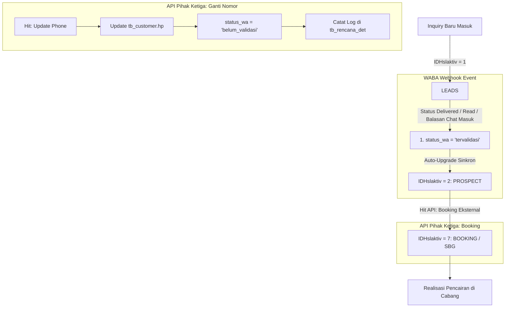

# Selada Advanced - Enterprise CRM & Sales Funnel Platform

Selada Advanced adalah platform modern CRM, Sales Funnel, dan Manajemen Transaksi Gadai yang dibangun dengan arsitektur micro-services:
* **Frontend**: Nuxt 3 (Vue 3, TypeScript, TailwindCSS)
* **Backend**: Go (Golang Gin Framework, GORM, PostgreSQL & MySQL)
* **Reverse Proxy**: Nginx Alpine
* **Containerization**: Docker Compose

---

## 🚀 Fitur Utama & Integrasi Baru

### 1. WhatsApp Business API (WABA) Webhook & Auto-Pipeline
* **Validasi Nomor WhatsApp**: Status WhatsApp nasabah (`status_wa = 'tervalidasi'`) otomatis tervalidasi saat pesan terkirim (`delivered`), dibaca (`read`), atau saat nasabah membalas chat.
* **Auto-Upgrade Leads $\rightarrow$ Prospect**: 
  * Validasi WA dan kenaikan status adalah **satu kesatuan**.
  * Begitu nomor WA tervalidasi atau ada balasan chat masuk, inquiry nasabah dari status **Leads (`id_hslaktiv = 1`)** otomatis dinaikkan menjadi **Prospect (`id_hslaktiv = 2`)** di riwayat aktivitas (`tb_rencana_det`).

### 2. API Eksternal Pihak Ketiga (Third-Party Integrations)
* **Update Nomor Telepon Customer (`POST /api/external/customer/update-phone`)**:
  * Mengubah nomor telepon nasabah di `tb_customer`.
  * Mereset `status_wa = 'belum_validasi'` agar diverifikasi ulang pada nomor baru.
  * Mencatat log riwayat perubahan nomor di `tb_rencana_det`.
* **Hit Booking Eksternal (`POST /api/external/booking`)**:
  * Menerima notifikasi booking dari website/aplikasi luar atau POS Gadai.
  * Mengubah status inquiry dari **Prospect (`id_hslaktiv = 2`)** $\rightarrow$ **Booking / SBG Deal (`id_hslaktiv = 7`)**.
  * Mencatat detail cabang tujuan, jadwal janji temu, dan estimasi pinjaman.

---

## 📊 Diagram Alur Pipeline Status



---

## 🛠️ Persiapan Database (PostgreSQL)

Pastikan kolom berikut sudah tersedia di database PostgreSQL Selada (`tb_customer`):

```sql
ALTER TABLE tb_customer 
ADD COLUMN IF NOT EXISTS status_wa VARCHAR(30) DEFAULT 'belum_validasi',
ADD COLUMN IF NOT EXISTS wa_validated_at TIMESTAMP NULL;

CREATE INDEX IF NOT EXISTS idx_customer_hp ON tb_customer(hp);
```

---

## 🐳 Cara Menjalankan dengan Docker Compose

### 1. Konfigurasi Environment (`.env`)
Salin file konfigurasi pada folder backend:
```bash
cp backend/.env-example backend/.env
```
Sesuaikan konfigurasi koneksi database PostgreSQL (`DB_PG2_*`), MySQL POS, dan port server.

### 2. Menjalankan Seluruh Service
```bash
# Build dan jalankan seluruh container (Backend, Frontend, Nginx)
docker-compose up -d --build

# Melihat log aktivitas
docker-compose logs -f backend
```

Layanan akan aktif pada port:
* **Nginx Gateway**: `http://localhost:8080`
* **Frontend Nuxt 3**: `http://localhost:3001`
* **Backend Go API**: `http://localhost:3000`

---

## 📖 Dokumentasi Endpoint Webhook & Eksternal

### 1. Webhook WhatsApp (Meta Cloud API / WABA Gateway)
Mendukung verifikasi challenge Meta dan penerimaan event pesan/status.

* **GET (Verifikasi Meta)**: `/api/webhook/whatsapp`
  * Parameter: `hub.mode=subscribe&hub.verify_token=selada_wa_webhook_token&hub.challenge=CHALLENGE_CODE`
* **POST (Event Receiver)**: `/api/webhook/whatsapp`
  * Content-Type: `application/json`

**Contoh Payload Status Delivered / Read (Auto-Validasi WA & Upgrade ke Prospect):**
```json
{
  "entry": [
    {
      "changes": [
        {
          "value": {
            "statuses": [
              {
                "id": "wamid.HBgLM...",
                "status": "delivered",
                "recipient_id": "6281299998888"
              }
            ]
          }
        }
      ]
    }
  ]
}
```

**Contoh Payload Pesan Masuk (Customer Membalas WA):**
```json
{
  "entry": [
    {
      "changes": [
        {
          "value": {
            "messages": [
              {
                "from": "6281299998888",
                "text": { "body": "Halo, saya berminat taksiran emas #1042" }
              }
            ]
          }
        }
      ]
    }
  ]
}
```

---

### 2. API Update Nomor Telepon Customer (Pihak Ketiga)
Digunakan ketika sistem eksternal atau aplikasi mobile mendeteksi nasabah mengganti nomor kontak.

* **URL**: `POST /api/external/customer/update-phone`
* **Headers**: 
  * `Content-Type: application/json`
  * `X-Api-Key: selada_external_secret_2026` *(atau isi di body)*

**Request Body:**
```json
{
  "api_key": "selada_external_secret_2026",
  "id_customer": 125,
  "old_phone": "081234567890",
  "new_phone": "081987654321",
  "reason": "Nasabah mengajukan pergantian nomor WhatsApp di aplikasi mobile",
  "updated_by": "Aplikasi Mobile Nasabah"
}
```

**Response (200 OK):**
```json
{
  "status": "success",
  "message": "Nomor telepon customer berhasil diperbarui dan status WA direset ke belum_validasi",
  "data": {
    "id_customer": 125,
    "nama": "Budi Santoso",
    "old_phone": "081234567890",
    "new_phone": "081987654321",
    "status_wa": "belum_validasi",
    "updated_at": "2026-10-27 15:00:00"
  }
}
```

---

### 3. API & Webhook Booking Eksternal (Ubah Status ke BOOKING Saat Booking Berhasil)
Digunakan saat sistem luar (web portal, landing page booking, aplikasi mobile, atau bot) menerima transaksi booking yang **berhasil**, lalu menembak Selada untuk mengubah status inquiry nasabah langsung menjadi **BOOKING (`id_hslaktiv = 7`)**.

* **Endpoint Tersedia**:
  * **API Endpoint**: `POST /api/external/booking` *(Menggunakan Header `X-Api-Key`)*
  * **Webhook Endpoint**: `POST /api/webhook/booking` *(Listener fleksibel untuk callback webhook)*
  * **Webhook Verification**: `GET /api/webhook/booking` *(Challenge & ping verification)*

* **Kemampuan Otomatis**:
  1. **Ubah Status ke BOOKING**: Inquiry nasabah dari status **Leads (1)** atau **Prospect (2)** langsung naik ke **Booking (7)**.
  2. **Auto-Validasi WA**: Status WhatsApp nasabah otomatis diset menjadi `status_wa = 'tervalidasi'` karena telah menyelesaikan proses booking.
  3. **Auto-Create Customer Baru**: Jika nasabah yang booking belum ada di database Selada, sistem otomatis membuat data customer dan inquiry baru berstatus Booking.
  4. **Pencatatan Detail Janji Temu**: Otomatis menyimpan cabang tujuan, jadwal janji temu, jenis barang jaminan, dan estimasi pinjaman ke log aktivitas `tb_rencana_det`.

**Request Body (Format Standar atau Webhook Payload):**
```json
{
  "api_key": "selada_external_secret_2026",
  "event": "booking_success",
  "reference_id": "BOOK-20261028-889",
  "phone": "081987654321",
  "nama": "Budi Santoso",
  "booking_details": {
    "tanggal_booking": "2026-10-29 10:00:00",
    "jenis_barang": "Emas / Logam Mulia Antam",
    "estimasi_pinjaman": 15000000,
    "cabang_tujuan": "Cabang Jakarta Pusat",
    "catatan": "Nasabah booking taksiran emas 15 gram via portal online"
  }
}
```

> **Catatan Fleksibilitas**: Sistem juga menerima format *flat* (tanpa objek `booking_details`) seperti:  
> `{"booking_id": "BK-001", "phone": "081987654321", "jadwal": "2026-10-29 10:00:00", "cabang": "Cabang Pusat", "barang": "Emas", "nominal": 15000000}`.

**Response (200 OK):**
```json
{
  "status": "success",
  "message": "Status inquiry berhasil diubah ke BOOKING",
  "data": {
    "id_rencana": 1042,
    "id_customer": 125,
    "nama_customer": "Budi Santoso",
    "hp": "081987654321",
    "reference_id": "BOOK-20261028-889",
    "previous_status": 2,
    "current_status": 7,
    "status_label": "Booking / SBG",
    "status_wa": "tervalidasi",
    "booking_details": {
      "cabang_tujuan": "Cabang Jakarta Pusat",
      "tanggal_booking": "2026-10-29 10:00:00",
      "jenis_barang": "Emas / Logam Mulia Antam",
      "estimasi_pinjaman": 15000000,
      "catatan": "Nasabah booking taksiran emas 15 gram via portal online"
    },
    "note": "[API Hit Booking #BOOK-20261028-889] Booking berhasil via Webhook/API...",
    "updated_at": "2026-10-28 11:00:00"
  }
}
```

---

### 4. Realisasi Pencairan SBG di Cabang (POS Gadai / Sopiga)
Tahapan lanjutan setelah nasabah berstatus **Booking (`id_hslaktiv = 7`)**:

1. **Kedatangan Nasabah di Cabang**:
   - Nasabah hadir di kantor cabang sesuai jadwal booking yang telah ditentukan.
2. **Pengecekan di Halaman Inquiry**:
   - Petugas cabang dapat memfilter status inquiry menggunakan opsi **"Booking / SBG Deal"** atau kartu metrik ungu di bagian atas.
   - Nasabah booking ditandai dengan badge khusus **`Booking / SBG`** dan icon centang hijau/ungu untuk langsung melanjutkan proses akad.
3. **Pencairan & Input SBG (`/input-sbg?id=...`)**:
   - Mengklik tombol aksi pada baris inquiry akan otomatis membuka form **Input SBG**.
   - Data nasabah, nomor kontak, dan riwayat booking (cabang tujuan, jadwal janji temu, jenis barang, dan estimasi pinjaman) langsung terisi secara otomatis (*pre-filled*).
   - Petugas memilih No. SBG resmi dari sistem POS Sopiga dan menekan **"Simpan SBG"**.

---

## 🧪 Panduan Uji Coba Cepat (cURL)

#### 1. Uji Webhook WA:
```bash
curl -X POST http://localhost:3000/api/webhook/whatsapp \
  -H "Content-Type: application/json" \
  -d '{"phone": "081987654321", "message": "Halo saya ingin konfirmasi pinjaman", "status": "delivered"}'
```

#### 2. Uji Update Nomor HP:
```bash
curl -X POST http://localhost:3000/api/external/customer/update-phone \
  -H "Content-Type: application/json" \
  -H "X-Api-Key: selada_external_secret_2026" \
  -d '{"old_phone": "081234567890", "new_phone": "081987654321", "reason": "Ganti nomor kartu SIM"}'
```

#### 3. Uji Hit Booking:
```bash
curl -X POST http://localhost:3000/api/external/booking \
  -H "Content-Type: application/json" \
  -H "X-Api-Key: selada_external_secret_2026" \
  -d '{"phone": "081987654321", "booking_details": {"tanggal_booking": "2026-10-28 10:00:00", "cabang_tujuan": "Cabang Jakarta Pusat", "jenis_barang": "Emas Antam 15 gr", "estimasi_pinjaman": 15000000, "catatan": "Booking janji temu via web portal"}}'
```

#### 4. Uji Verifikasi di Frontend:
Buka web browser pada URL: `http://localhost:3001/inquiry`
- Klik kartu **Booking / SBG Deal** (warna ungu) di baris metrik.
- Perhatikan baris nasabah: status tampil **Booking / SBG** dengan badge **WA Valid**.
- Klik tombol icon centang untuk membuka form **Input SBG** dengan data konteks booking otomatis terisi.
